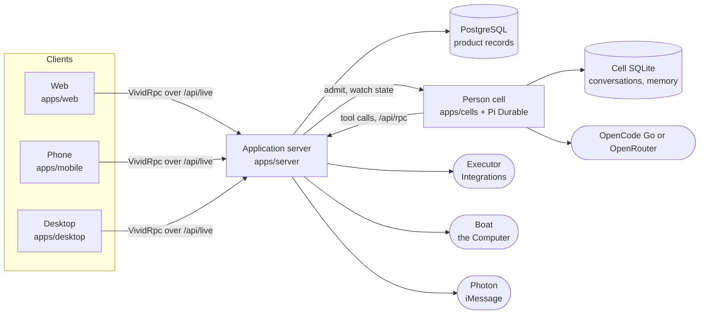
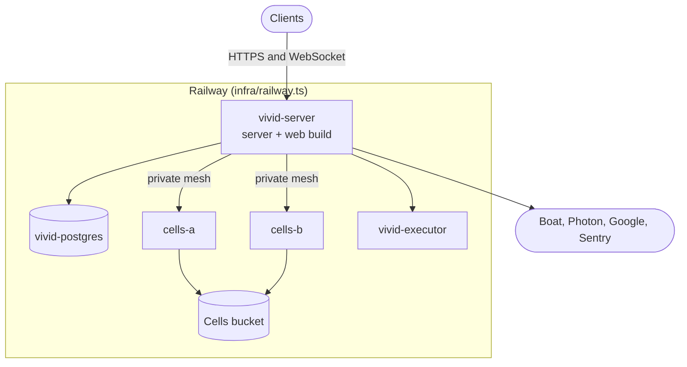

# Lucid

Lucid is an AI teammate for personal and shared work through conversations called Threads.
It uses connected services and a remote Computer to carry out requests and report progress.

The public page is https://lucid.konan.sh. Code identifiers keep the earlier name: packages are
`@vivid/*`, the RPC group is `VividRpc`, and settings start with `VIVID_`.

## What a Person can do

The code in this repository implements these capabilities.

- Conversations. Chat with streaming replies, send more instructions while Lucid works, and stop work.
  Search and organize Threads. Attach pictures to private Threads and answer questions through cards and forms.
  Replies can include interactive tables, charts, maps, and schedules.
- Shared work. Create Companies, invite members, set roles, and share Threads with attributed messages.
  Create nested Projects with goals, next steps, progress, and completion proof.
- Tasks and background work. Keep to-dos and waiting-on items in the Feed.
  Ask Lucid to watch Integration events or arrange check-ins through a timer Integration.
  A check-in is scheduled only after the provider confirms it. Inspect or stop background work in Settings.
- Integrations and approval. Connect service accounts, add Integrations through MCP addresses or OpenAPI documents, and ask Lucid to use them.
  Review outgoing drafts, allow or decline actions, set plain-language rules, and read the action record.
- Library and generated work. Upload PDF, Markdown, and plain-text files up to 10 MiB each into folders.
  Ask questions with filename and page citations through keyword search.
  Read, edit, share, and browse versions of generated Markdown documents. Receive generated files with previews and saved editable sources.
- Memory. Inspect, search, correct, or forget saved facts and preferences. Read the sources attached to saved memories.
  Ask Lucid to recall earlier conversations.
- Computer and helpers. Ask Lucid to browse, run commands and JavaScript, and use files and desktop apps on its persistent remote Computer.
  The Computer image includes office, creative, and engineering apps with an application finder.
  Watch the screen, take over, hand back, or turn the Computer off. Lucid can delegate independent parts of a request to helpers.
- Messaging. Text Lucid through iMessage. Discord is available when its bot is configured. WhatsApp is unavailable.

## How it fits together

Three clients talk to one application server over a WebSocket. The server keeps product records in
PostgreSQL and hands each conversation to a Person cell: one celld Durable Object per Person, which
runs the agent with Pi Durable and keeps conversation history and memory in its own SQLite
database. The agent calls back into the server for every product action, so authorization happens
in one place.



[Architecture](docs/29-architecture.md) follows one message through every hop, with the file that
handles each one.

## Components

| Directory                | What it is                                                                                                                                                                  |
| ------------------------ | --------------------------------------------------------------------------------------------------------------------------------------------------------------------------- |
| `apps/web`               | Browser app: Vite, React 19, TanStack Router, Tailwind 4                                                                                                                    |
| `apps/mobile`            | Phone app: Expo 57 and React Native, with iOS dictation, Live Activities, widgets, shortcuts and notification actions. See [the mobile README](apps/mobile/README.md)       |
| `apps/desktop`           | Electron around the web renderer, with browser tabs, native notifications and permitted access to the Person's own device. See [the desktop README](apps/desktop/README.md) |
| `apps/server`            | Product domains, authorization and PostgreSQL records. See [the server README](apps/server/README.md)                                                                       |
| `apps/cells`             | The celld Worker that hosts one Person cell per Person                                                                                                                      |
| `packages/contracts`     | Wire schemas and `VividRpc`, the one declaration of every product call                                                                                                      |
| `packages/client/rpc`    | RPC clients derived from `VividRpc`, over HTTP and WebSocket                                                                                                                |
| `packages/client/state`  | Live queries, caches and optimistic sends shared by web and phone                                                                                                           |
| `packages/agent/runtime` | Pi Durable conversation execution, instructions, model providers and tools                                                                                                  |
| `packages/agent/skills`  | Built-in skill procedures                                                                                                                                                   |
| `packages/design`        | Tokens, and the geometry of Lucid's face and service marks                                                                                                                  |
| `infra`                  | The Alchemy stack for local development and production                                                                                                                      |

## Infrastructure

Alchemy declares both environments in `alchemy.run.ts`. Locally, `pnpm infra:dev` starts
PostgreSQL 18 in Docker, the migrations, a celld Worker, the server and the web client. Production
runs in one Railway project: the server is built from `main` and also serves the web app, two
celld nodes run the Person cells, and Executor runs beside them.



Before a new server takes traffic, Railway runs `infra/predeploy.mjs` in the new image: migrations,
source maps to Sentry, then the cell Worker, read back from the bucket. A failed step keeps the
previous server running. [Architecture](docs/29-architecture.md#infrastructure) has the full
resource list and the release sequence, and [Infrastructure](docs/19-infrastructure.md) has every
setting.

## Run locally

Use Node 24 or newer, pnpm `12.4.2`, Docker for PostgreSQL, and celld `0.6.2` on `PATH`.
Supply the required credentials in the process environment before starting the stack.
These include model keys, runtime authority, Google sign-in, Executor, Boat, Photon, and push settings.
Use [the infrastructure setup](docs/19-infrastructure.md#run-locally) and `infra/env.ts` for the full configuration.
The root `.env.example` alone is insufficient.

```sh
pnpm install
pnpm infra:verify
pnpm infra:dev
```

Alchemy starts PostgreSQL 18 on port `55433`, native celld development mode on `5173`,
the application server on `8787`, and the web client on `5178`. Startup applies auth migrations before product migrations.
The infrastructure guide records a known local sign-in origin mismatch.

Keep the real local database, cell storage, and Alchemy state read/copy only during tests and audits.
Product database tests use disposable PostgreSQL through `VIVID_TEST_DATABASE_URL`.
Runtime proofs use disposable cells with native Pi SQLite.

Workspace catalogs, overrides, build approvals, and patches live in `pnpm-workspace.yaml`.
`packageManager` and `engines.pnpm` in `package.json` pin pnpm.

## Verification

`pnpm gate` runs the repository checks defined in `scripts/gate/stages.mjs` and replays unchanged tasks.
The push hook runs the same gate. `pnpm gate affected` and `pnpm gate focused <test files>` support narrower checks.
See [the check pipeline](docs/checks.md) for prerequisites and execution hosts.

Product behavior is checked through [the verify-vivid skill](.agents/skills/verify-vivid/SKILL.md)
and its [feature map](.agents/skills/verify-vivid/features/README.md).
Run the named features on a Cloudbox devbox selected by `~/bin/devbox-pick`:

```sh
pnpm verify feed settings
```

The command sends this checkout to a warm verification tree, launches disposable stores and the real product,
requires a worthy Doctor result, runs each feature and browser recipe, and cleans up.
Evidence stays under `.cache/verify/` on that host. Reports name the feature file, exact head,
working-tree status, model, host, and evidence path. Blocked features and scripted rehearsal do not establish verified behavior.
The skill marks the native cell launcher and product journeys unproven until a real run passes.

## Documentation map

Documents in `docs/` include design decisions, implementation notes, and historical research.
Older product inventories do not establish current behavior.

- [Architecture](docs/29-architecture.md) shows the components, the path of one message, and the
  local and production infrastructure, with diagrams.
- [Structure](docs/00-structure.md) maps ownership and file placement.
- [Principle](docs/01-principle.md), [Surface](docs/03-surface.md), and [Product definition](docs/23-product-definition.md)
  describe product intent. [One product](docs/22-one-product.md) records the personal and Company model.
- [Computer](docs/04-computer.md), [Communication](docs/06-communication.md), and [Company and projects](docs/12-company-and-projects.md)
  describe those domains and their design decisions.
- [Main screen](docs/07-main-screen.md), [Design language](docs/08-design-language.md), and [Design-system lint](docs/designlint.md)
  cover interface design and its enforced contracts.
- [Infrastructure](docs/19-infrastructure.md) covers configuration and local setup.
  [Executor scale](docs/24-executor-scale.md) covers the Integration service.
- [Memory](docs/25-memory.md), [Memory cells](docs/26-memory-cells.md), and [Runtime cells](docs/27-runtime-cells.md)
  describe cell ownership, storage, and required proofs.
- [Check pipeline](docs/checks.md), [State machines](docs/statecharts.md), [Typing investigation](docs/typing.md),
  and [Signals](docs/signals.md) cover engineering checks and client behavior.
- [Feature status and Grok Bot parity](docs/14-product-feature-set-and-grok-bot-parity.md) is a historical inventory last updated on 3 October 2026.
  [References](docs/02-references.md) and [Reference mining](docs/21-reference-mining.md) collect earlier research.
