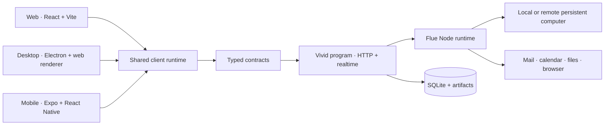

# Platform architecture

**Status:** Direction for implementation  
**Updated:** 2 September 2026

Vivid is one long-lived program first, with web, desktop, and mobile as clients. The program owns
the agent runtime, durable state, scheduling, permissions, and computer. It runs unchanged on a
laptop or ordinary VM; no cloud provider defines its internal model.

Clients share one product model without forcing one UI implementation onto every platform. This
follows the useful boundary in the local T3 Code repository: its browser and Electron apps share a
renderer, while its Expo app has a native UI over shared contracts and client runtime.

## What T3 Code does

The local `t3code-cloudbox` source shows this split:

| Part            | T3 Code implementation                                          | Useful lesson for Vivid                                                                                    |
| --------------- | --------------------------------------------------------------- | ---------------------------------------------------------------------------------------------------------- |
| Web             | React 19, Vite, Tailwind 4, TanStack Router                     | Keep the browser client fast and ordinary.                                                                 |
| Desktop         | Electron shell around the web renderer                          | Reuse the web UI where desktop and browser behavior match. Add native bridges only for OS capabilities.    |
| Mobile          | Separate Expo and React Native UI                               | Share behavior and data, not DOM components. Use native navigation and controls on phones.                 |
| Backend         | Effect-based Node service with HTTP and RPC/WebSocket transport | Put agent execution, machine access, and durable work outside the UI. Stream typed events to every client. |
| Shared packages | Contracts, client runtime, utilities, theme palettes            | Make schemas and state transitions the stable cross-platform boundary.                                     |

## Vivid target

### Applications

- `apps/web`: the current Vite app. It owns browser routing, responsive layout, and web accessibility.
- `apps/desktop`: an Electron host for the web build. It owns window chrome, updates, notifications, deep links, and local-device bridges.
- `apps/mobile`: an Expo app with native thread, attention, approval, and notification screens. It consumes the same contracts and runtime but not the web component tree.
- `apps/server`: the entrypoint for the Vivid program: authenticated API, realtime stream, agent
  loop, schedules, permission gates, connector calls, file-backed SQLite, and computer supervision.
  Flue Node owns agent admission, conversation history, streaming, and restart reconciliation. The
  name does not imply a separately hosted backend.

### Shared packages

- `packages/contracts`: request, response, event, thread, approval, and task schemas.
- `packages/client-runtime`: a framework-neutral Vivid store over Flue observation, plus connection
  state, optimistic updates, event reduction, offline queue, and product command methods.
- `packages/domain`: pure Vivid rules such as thread state and permission decisions.
- `packages/design/tokens`: colors, type, spacing, radii, and semantic status names. Web exports CSS variables; mobile exports TypeScript values.

## Runtime flow

1. A client sends a typed command such as `thread.message.send`.
2. The server validates it, stores it, and hands the work to the agent runtime.
3. The agent uses the private computer or a connector behind the relevant permission gate.
4. The server emits typed progress, question, approval, and completion events.
5. Every signed-in client reduces those events into the same thread state.

The same program may run on the user's laptop or their persistent Vivid machine. Desktop and mobile
connect to its one authenticated service boundary. Hosting changes reachability, not runtime
semantics.

## Theme and settings

Theme is a user preference with three values: `system`, `light`, and `dark`. The UI derives the resolved appearance from that preference and the OS color scheme. Web stores the preference locally for now; the server can later sync the same preference across devices. The semantic tokens stay identical across platforms even when their rendering implementations differ.

## Implementation order

1. Run one real agent loop inside the local Vivid program.
2. Configure Flue with a file SQLite path, then prove recovery by killing and restarting it mid-task.
3. Give it the real local computer path: filesystem, subprocesses, and browser.
4. Serve the existing Vite UI and stream runtime events into the thread.
5. Package the same program and state directory for a generic Linux VM or container.
6. Add Electron and native mobile clients after the runtime protocol is earned by real behavior.

AI Elements remains the web presentation layer. Its source-owned components render Vivid's message
view model; `useChat` is not the canonical state owner because it cannot faithfully represent
Flue's durable snapshots, multiple writers, queued submissions, and settlements.

Do not design contracts backwards from hypothetical clients or deployment providers. Extract a
boundary after the running agent proves it exists.
