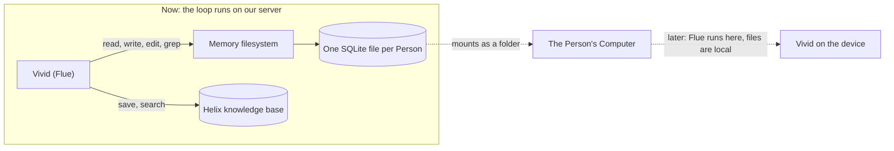

# Memory: a filesystem per Person, and Helix as the knowledge base

**Status:** direction, 4 October 2026. Documented at Konan's request after the design discussion of
that day. Nothing in "The direction" is built into the product yet. The combination it relies on
was run as a proof the same day: see "Proof" and "Not verified". It replaces the memory part of [One product](22-one-product.md) as the
target; "What exists today" describes what the code does until it lands.

Evidence is the primary source of each reference system, read on 4 October 2026: the installed Flue
documentation (`pnpm exec flue docs read guide/sandboxes`, `guide/durability`,
`reference/sandbox-api`), and the upstream repositories of AgentFS (`tursodatabase/agentfs`,
specification v0.4), just-bash (`vercel-labs/just-bash`), Eve (`vercel/eve`), Cloudflare Agents
(`cloudflare/agents`), Letta Code (`letta-ai/letta-code`), and Anthropic's memory tool and Claude
Code memory documentation. A claim marked **unverified** was read from source and not run.

## The direction

1. **Memory is a filesystem.** Each Person has one small filesystem that Vivid manages itself. It is
   stored in one SQLite file per Person (AgentFS). It is attached through Flue's filesystem slot
   (`useSandbox`), so Vivid reads and edits it with ordinary file tools.
2. **The layout is the Claude Code layout.** One index is always in front of the model. Each
   memory is one file with a small typed header, opened only when its index line looks relevant.
3. **The knowledge base is Helix.** Durable facts and search live there. Vivid writes to it with a
   tool. It is a separate layer from memory and is more durable.
4. **On the Computer, the same SQLite file mounts as a real folder.** Later, when Flue runs on the
   device, the files are simply local files. The end state is Vivid on the device, not the device
   reached from a server.



## Why a filesystem

Konan asked for "instant memory like yours": the memory of a coding tool, which is files, not a
database behind tools. The requirements from that discussion:

- **Always there.** What Vivid knows is in front of the model on every response, with no tool call
  and no second model. A search-backed store cannot give that.
- **Managed by Vivid.** Vivid writes a memory at the moment it matters, and updates or deletes a
  note instead of adding a duplicate.
- **Typed, not restrictive.** A note has a small typed header; its body is free text.
- **Portable.** The same memory must follow Vivid onto the Person's device.

Models are trained on filesystems and file tools. Every reference that gives a model durable notes
converges on files, or on a document shaped like one.

## The layout

Ported from Claude Code's file memory; Letta's memory filesystem uses the same shape.

```
/                      the memory folder is the filesystem root
  <name>.md            one memory per file
```

- **The index** is one line per memory (file, type, description) and is always in front of the
  model. Vivid's server derives it from the notes' headers on every response; the model does not
  keep an index file (see "Proof"). Claude Code keeps a hand-written `MEMORY.md` of
  `- [Title](file.md) — one-line hook` lines and loads its first 200 lines or 25 KB.
- **A memory file** starts with a header and then holds the fact:

  ```markdown
  ---
  name: <short-kebab-case-slug>
  description: <one line, used to decide whether to open this file>
  type: <kind of memory>
  ---

  <the fact; for a preference or a decision, then **Why:** and **How to apply:**>
  ```

- **Rules Vivid follows**, from the same source: save only what will change later behaviour and will
  still be true in a later session; update the existing file instead of writing a second one;
  delete a memory that turned out wrong; a memory can be stale, so check it before acting on it.

The `type` vocabulary is Vivid's own. Today's kinds are fact, preference, person, organization,
decision and workstream (`packages/contracts/src/memory.ts`); whether the files keep exactly these
is open.

## How it attaches to Flue

Flue gives an agent a filesystem through one slot, the sandbox (`useSandbox`). With a sandbox
attached, the model gets `read`, `write`, `edit`, `grep`, `glob` and `bash`, and Flue puts the
working directory's listing and its `AGENTS.md` into the system prompt at initialization.

- Flue's built-in virtual sandbox is the just-bash engine, and just-bash accepts any filesystem
  behind its `IFileSystem` interface (`new Bash({ fs })`).
- AgentFS ships that adapter (`agentfs-sdk/just-bash`): a full filesystem in one SQLite database,
  with tables for inodes, directory entries and 4,096-byte data chunks.
- So the chain is Flue → just-bash → AgentFS → one SQLite file per Person. The same file can be
  mounted as a folder on Linux (`agentfs mount`), which is how it appears on the Computer. To move a
  Person's memory, copy one file.
- On the device, the same agent code attaches `local()` instead: the real disk.

Three facts about Flue shape the work:

- **One sandbox per agent.** The slot is in use today, but only by a placeholder whose file
  operations all answer "unsupported": it exists so the Computer's screenshot tool can return
  images, which Flue passes through `SandboxFactory.tools`
  (`packages/agent/runtime/src/tools/computer.ts`, `desktopToolFactory`). A real filesystem takes
  the slot and carries that tool with it.
- **A sandbox is keyed by conversation.** Flue hands the factory the conversation's instance id.
  Memory belongs to a Person across every Thread, so the factory resolves the acting Person and
  opens that Person's file.
- **The system prompt is frozen at initialization** and refreshed only at compaction. The index is
  therefore placed in front of the model on every response through the context path
  (`packages/agent/runtime/src/context.ts`), not left to Flue's one-time workspace discovery.

Flue also has per-conversation persistent state (`usePersistentState`). It lives for one
conversation only, so it is not memory.

## The knowledge base

Helix stays, as the durable layer: facts that should outlive memory, found by search
(`apps/server/src/memory/helix.ts`, `store.ts`).

- Vivid writes to it with a tool, and learning after a Run still extracts candidates into it.
- The decision model (Jev, through `apps/server/src/decisions/model.ts`) selects which candidates
  are kept. With decisions switched off, everything extracted is kept.
- A write is applied at most once per candidate, however often a Run is replayed. The receipt
  design, its review and its proof are tracked in issue #16.

What goes to memory and what goes to the knowledge base, and whether one feeds the other, is open.

## What exists today

- Facts are `Memory` records in Helix: one sentence, a kind, and a scope (Person, Company, Thread).
- The runtime reads a memory brief through `MemoryAccess.brief` in
  `apps/server/src/memory/store.ts`. Its cache key includes the authorized memories and Person.
  A cache miss asks the extraction model to summarize those memories; successful summaries are
  cached for ten minutes. The former memory page module and `GetMemoryPage` are no longer used.
- The model's knowledge-base tools are `recall` and `remember`. It changes and removes what it
  knows on its notes (`read_note`, `write_note`, `delete_note`); a Person corrects and removes
  knowledge-base facts in Settings.
- Nothing seeds memory. A new Person starts with no facts; no write happens at sign-up or
  onboarding.
- On 4 October 2026 the production Helix held no memories. Learning is not called for a Run that
  finishes through an Approval continuation or after recovery; that is tracked in issue #16.

The page is the always-on path the filesystem index will use. Its source changes from Helix records
to the index derived from the notes' headers.

## The references, side by side

| System                | Where memory lives                        | Always in the prompt                 | Model's tools                                                 |
| --------------------- | ----------------------------------------- | ------------------------------------ | ------------------------------------------------------------- |
| Claude Code           | Markdown files on disk                    | `MEMORY.md`, first 200 lines / 25 KB | ordinary file tools                                           |
| Letta memory files    | Markdown files in a Git repository        | root files and the index             | ordinary file tools, plus Git                                 |
| Eve                   | one `MEMORY.md` document in blob storage  | the whole document, 4,000 characters | `save_memory`, `remove_memory`                                |
| Cloudflare Think      | named blocks in the agent's SQLite        | the blocks, each with a token budget | `set_context`, `search_context`                               |
| AgentFS               | a full filesystem in one SQLite file      | the application chooses              | file tools through just-bash                                  |
| Anthropic memory tool | a `/memories` folder the application owns | instructions only                    | `view`, `create`, `str_replace`, `insert`, `delete`, `rename` |

Eve's shape (one bounded document, two tools) is the simpler alternative. It was not chosen: it has
no folders and no note bodies, a Person cannot open it as files, and it does not move onto the
Computer.

## Proof, run on 4 October 2026

Run in an isolated folder against Flue 2.2.2 (the pinned version), just-bash 3.6.0 and agentfs-sdk
0.6.4, with the product's gateway and default model (`explabs/glm-5.3-flash`). No production data.

**What ran and passed**

- **Files persist in one SQLite file, across processes and conversations.** Flue's `write`, `edit`,
  `read` and `glob` tools and the shell wrote and changed notes; a new process with a different
  conversation id read them back. Opening the database took 57 to 97 ms; reading the index took
  2.8 ms; a tool call took 3 to 50 ms.
- **A real model keeps and uses its memory this way.** Told two facts in one conversation, the model
  wrote two note files with the header and a Why / How to apply body, and answered. In a new process
  and a new conversation, asked a question that depended on both, it read both files and applied
  them (18 to 21 s to teach, 13 s to answer, tool calls included).
- **Overwriting and concurrent writes are sound.** Overwriting an empty, shorter or longer file, and
  three writes at once for twenty rounds, left the right bytes every time.

**What the run changed in the design**

- **AgentFS's adapter lags just-bash 3.** Flue 2.2.2 needs just-bash `^3.0.1`, which calls
  `realpath` and `utimes`; agentfs-sdk 0.6.4 has neither, and the first shell command crashed. Vivid
  owns a small adapter that adds them: `realpath` resolves the path and requires it to exist;
  `utimes` does nothing, because AgentFS sets its own modification time on write.
- **Flue's `grep` tool does not work on any just-bash 3.x**, with or without AgentFS: it runs
  `grep -rnH`, and just-bash's `grep` has no `-H`, so it reports "No matches found". Search goes
  through the shell (`rg -n`, which works) or a tool of our own. Flue's `glob` tool passes its
  pattern to `find -name`, so `*.md` works and `**/*.md` finds nothing.
- **The memory folder is the filesystem root.** With the notes in `/memory/`, the model wrote its
  index to `/MEMORY.md` and the notes to `/memory/`, so the index the next conversation read was
  empty. With the folder as the root and relative paths, there is nowhere else to write.
- **The index is derived, not kept by the model.** It is built from each note's header (file, type,
  description) on every response: 5 ms for two notes. A hand-kept `MEMORY.md` can drift from the
  files; a derived one cannot. This departs from Claude Code, where the model keeps the index.

**Behaviour test, the same day.** Ten scenarios, three runs each, every turn a new conversation so
that only the files carry over; 51 model turns, 58 tool calls, no tool error. Median turn 9 s, the
slowest 21 s.

| Scenario                                                          | Passed |
| ----------------------------------------------------------------- | ------ |
| Saves a durable fact as a note with a header                      | 3 of 3 |
| Writes nothing for arithmetic or small talk                       | 3 of 3 |
| Does not store a password or a one-message instruction            | 3 of 3 |
| Applies two remembered facts to a later question                  | 3 of 3 |
| A changed preference edits the same note; no second note          | 3 of 3 |
| "Forget my gym" deletes that note and keeps the other             | 3 of 3 |
| "Tolu, not Tobi" fixes the note and the next answer               | 3 of 3 |
| With 81 notes, finds the one that matters, opening one note       | 3 of 3 |
| With 81 notes, an unrelated question opens no note                | 3 of 3 |
| The Person contradicts a note: believes them and updates the note | 3 of 3 |

In one of the three recall runs the model answered correctly from the index line alone, without
opening the note. The index for 81 notes was 6,737 characters.

## Not verified

- The Computer's screenshot tool beside the file tools in the same Flue slot. The slot's `tools`
  list was used for the file tools in the proof; the desktop tool was not in it.
- Mounting the SQLite file as a folder on the Computer (`agentfs mount`).
- The product path. The behaviour test used a small harness with memory instructions only; Vivid's
  real prompt is much longer and its other tools compete for the model's attention.
- Long conversations, and two conversations writing at the same moment.
- Many notes: the index grows about 83 characters a note, so a few hundred notes need a budget and
  a rule for what stays on it.
- The write-ahead log: a 4 KB database carried a 424 KB log after one run; closing and checkpointing
  are not designed.
- AgentFS is young (specification v0.4).
- How Grok Bot lays out and syncs its own memory files. Its source was not found during this
  research; [The Computer](04-computer.md) records that its persistence is state sync, not the
  machine.

## Open questions

Vivid is being built for one Person's own use first. Sharing, and who sees what in a shared Thread,
is out of scope for now; today's access rules stay as they are in code.

1. **Seeding.** Whether sign-up and onboarding write the first notes (name, the onboarding answers,
   time zone).
2. **Where the SQLite file sits while the loop runs on our server**, and how it is backed up and
   synced to the Computer.
3. **Memory and the knowledge base.** Which facts go where, and whether learning after a Run writes
   files, Helix records, or both.
4. **The Person's view.** A Settings surface for memory comes after the model side is right.
