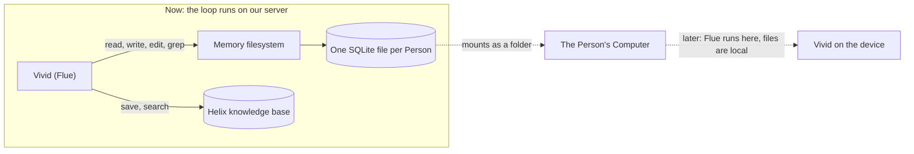

# Memory: a filesystem per Person, and Helix as the knowledge base

**Status:** direction, 4 October 2026. Documented at Konan's request after the design discussion of
that day. Nothing in "The direction" is built yet, and the combination it relies on has not been
run: see "Not verified". It replaces the memory part of [One product](22-one-product.md) as the
target; "What exists today" describes what the code does until it lands.

Evidence is the primary source of each reference system, read on 4 October 2026: the installed Flue
documentation (`pnpm exec flue docs read guide/sandboxes`, `guide/durability`,
`reference/sandbox-api`), and the upstream repositories of AgentFS (`tursodatabase/agentfs`,
specification v0.4), just-bash (`vercel-labs/just-bash`), Eve (`vercel/eve`), Cloudflare Agents
(`cloudflare/agents`), Letta Code (`letta-ai/letta-code`), and Anthropic's memory tool and Claude
Code memory documentation. A claim marked **unverified** was read from source and not run.

## The direction

1. **Memory is a filesystem.** Each Person has one small filesystem that Vivid manages itself. It is
   stored in one SQLite file per Person (AgentFS). It is attached through Flue's filesystem slot
   (`useSandbox`), so Vivid reads and edits it with ordinary file tools.
2. **The layout is the Claude Code layout.** One index file is always in front of the model. Each
   memory is one file with a small typed header, opened only when its index line looks relevant.
3. **The knowledge base is Helix.** Durable facts and search live there. Vivid writes to it with a
   tool. It is a separate layer from memory and is more durable.
4. **On the Computer, the same SQLite file mounts as a real folder.** Later, when Flue runs on the
   device, the files are simply local files. The end state is Vivid on the device, not the device
   reached from a server.



## Why a filesystem

Konan asked for "instant memory like yours": the memory of a coding tool, which is files, not a
database behind tools. The requirements from that discussion:

- **Always there.** What Vivid knows is in front of the model on every response, with no tool call
  and no second model. A search-backed store cannot give that.
- **Managed by Vivid.** Vivid writes a memory at the moment it matters, and updates or deletes a
  note instead of adding a duplicate.
- **Typed, not restrictive.** A note has a small typed header; its body is free text.
- **Portable.** The same memory must follow Vivid onto the Person's device.

Models are trained on filesystems and file tools. Every reference that gives a model durable notes
converges on files, or on a document shaped like one.

## The layout

Ported from Claude Code's file memory; Letta's memory filesystem uses the same shape.

```
/memory/
  MEMORY.md            index, always loaded: one line per memory
  <name>.md            one memory per file
```

- **`MEMORY.md`** has one line per memory: `- [Title](file.md) — one-line hook`, each under about
  150 characters. It has no header. Claude Code loads the first 200 lines or 25 KB of it.
- **A memory file** starts with a header and then holds the fact:

  ```markdown
  ---
  name: <short-kebab-case-slug>
  description: <one line, used to decide whether to open this file>
  type: <kind of memory>
  ---

  <the fact; for a preference or a decision, then **Why:** and **How to apply:**>
  ```

- **Rules Vivid follows**, from the same source: save only what will change later behaviour and will
  still be true in a later session; update the existing file instead of writing a second one;
  delete a memory that turned out wrong; a memory can be stale, so check it before acting on it.

The `type` vocabulary is Vivid's own. Today's kinds are fact, preference, person, organization,
decision and workstream (`packages/contracts/src/memory.ts`); whether the files keep exactly these
is open.

## How it attaches to Flue

Flue gives an agent a filesystem through one slot, the sandbox (`useSandbox`). With a sandbox
attached, the model gets `read`, `write`, `edit`, `grep`, `glob` and `bash`, and Flue puts the
working directory's listing and its `AGENTS.md` into the system prompt at initialization.

- Flue's built-in virtual sandbox is the just-bash engine, and just-bash accepts any filesystem
  behind its `IFileSystem` interface (`new Bash({ fs })`).
- AgentFS ships that adapter (`agentfs-sdk/just-bash`): a full filesystem in one SQLite database,
  with tables for inodes, directory entries and 4,096-byte data chunks.
- So the chain is Flue → just-bash → AgentFS → one SQLite file per Person. The same file can be
  mounted as a folder on Linux (`agentfs mount`), which is how it appears on the Computer. To move a
  Person's memory, copy one file.
- On the device, the same agent code attaches `local()` instead: the real disk.

Three facts about Flue shape the work:

- **One sandbox per agent.** The slot is in use today, but only by a placeholder whose file
  operations all answer "unsupported": it exists so the Computer's screenshot tool can return
  images, which Flue passes through `SandboxFactory.tools`
  (`packages/agent/runtime/src/tools/computer.ts`, `desktopToolFactory`). A real filesystem takes
  the slot and carries that tool with it.
- **A sandbox is keyed by conversation.** Flue hands the factory the conversation's instance id.
  Memory belongs to a Person across every Thread, so the factory resolves the acting Person and
  opens that Person's file.
- **The system prompt is frozen at initialization** and refreshed only at compaction. The index is
  therefore placed in front of the model on every response through the context path
  (`packages/agent/runtime/src/context.ts`), not left to Flue's one-time workspace discovery.

Flue also has per-conversation persistent state (`usePersistentState`). It lives for one
conversation only, so it is not memory.

## The knowledge base

Helix stays, as the durable layer: facts that should outlive memory, found by search
(`apps/server/src/memory/helix.ts`, `store.ts`).

- Vivid writes to it with a tool, and learning after a Run still extracts candidates into it.
- The decision model (Jev, through `apps/server/src/decisions/model.ts`) selects which candidates
  are kept. With decisions switched off, everything extracted is kept.
- A write is applied at most once per candidate, however often a Run is replayed. The receipt
  design, its review and its proof are tracked in issue #16.

What goes to memory and what goes to the knowledge base, and whether one feeds the other, is open.

## What exists today

- Facts are `Memory` records in Helix: one sentence, a kind, and a scope (Person, Company, Thread).
- Before each response the runtime loads the **page**: the stored facts themselves, newest first,
  one per line, bounded to about 2,000 tokens, with a note when older facts exist. No model runs on
  that path (`apps/server/src/memory/page.ts`, `MemoryAccess.page`, `GetMemoryPage`). It replaced a
  model-written brief of at most 300 words that was rebuilt whenever a fact changed.
- The model's tools are `remember`, `recall`, `correct` and `forget`.
- Nothing seeds memory. A new Person starts with no facts; no write happens at sign-up or
  onboarding.
- On 4 October 2026 the production Helix held no memories. Learning is not called for a Run that
  finishes through an Approval continuation or after recovery; that is tracked in issue #16.

The page is the always-on path the filesystem index will use. Its source changes from Helix records
to `MEMORY.md`.

## The references, side by side

| System                | Where memory lives                        | Always in the prompt                 | Model's tools                                                 |
| --------------------- | ----------------------------------------- | ------------------------------------ | ------------------------------------------------------------- |
| Claude Code           | Markdown files on disk                    | `MEMORY.md`, first 200 lines / 25 KB | ordinary file tools                                           |
| Letta memory files    | Markdown files in a Git repository        | root files and the index             | ordinary file tools, plus Git                                 |
| Eve                   | one `MEMORY.md` document in blob storage  | the whole document, 4,000 characters | `save_memory`, `remove_memory`                                |
| Cloudflare Think      | named blocks in the agent's SQLite        | the blocks, each with a token budget | `set_context`, `search_context`                               |
| AgentFS               | a full filesystem in one SQLite file      | the application chooses              | file tools through just-bash                                  |
| Anthropic memory tool | a `/memories` folder the application owns | instructions only                    | `view`, `create`, `str_replace`, `insert`, `delete`, `rename` |

Eve's shape (one bounded document, two tools) is the simpler alternative. It was not chosen: it has
no folders and no note bodies, a Person cannot open it as files, and it does not move onto the
Computer.

## Not verified

- **The combination has never been run.** Flue, just-bash and AgentFS were read, not executed
  together; their versions may not fit. The first step is a proof: write a note, restart, read it
  back, with the Computer's screenshot tool still working in the same slot.
- AgentFS is young (specification v0.4).
- Whether every Person has a Computer today, and whether its files can be read while it is stopped.
- How Grok Bot lays out and syncs its own memory files. Its source was not found during this
  research; [The Computer](04-computer.md) records that its persistence is state sync, not the
  machine.

## Open questions

1. **Shared Threads.** Several People are in one. The proposal keeps today's rule: the Thread has
   its own small folder, Company knowledge is visible, and no Person's private files appear there.
2. **Seeding.** Whether sign-up and onboarding write the first notes (name, the onboarding answers,
   time zone, Company).
3. **Where the SQLite files sit while the loop runs on our server**, and how they are backed up and
   synced to the Computer.
4. **Memory and the knowledge base.** Which facts go where, and whether learning after a Run writes
   files, Helix records, or both.
5. **The Person's view.** A Settings surface for memory comes after the model side is right.
