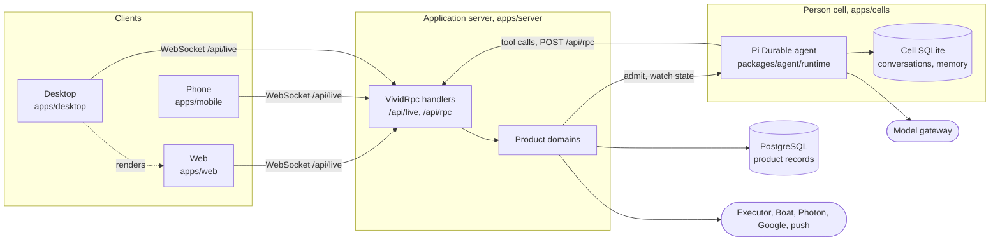
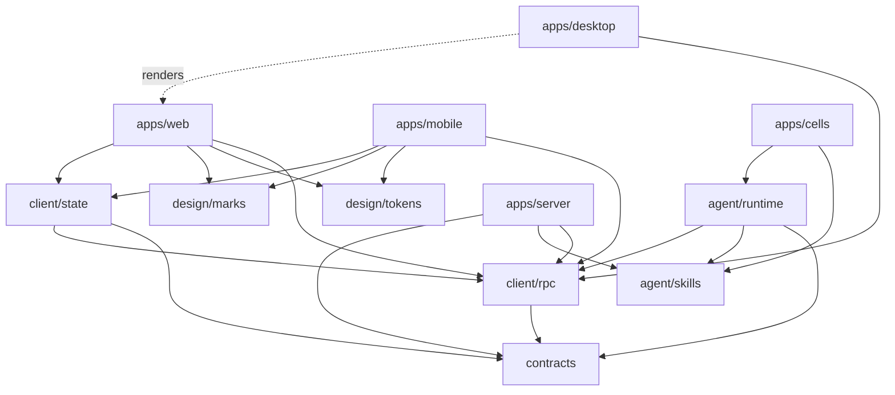
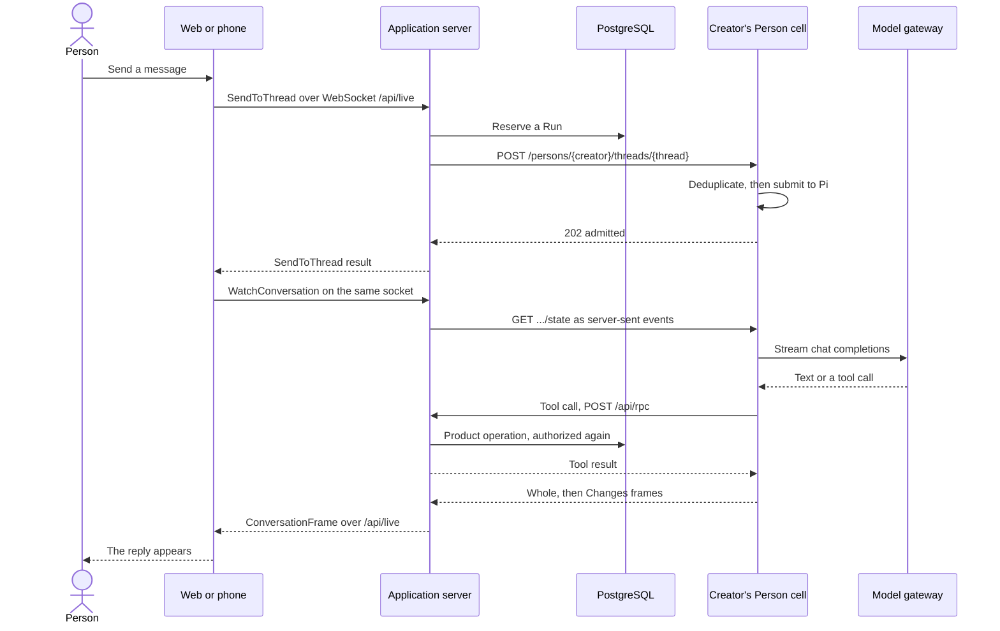
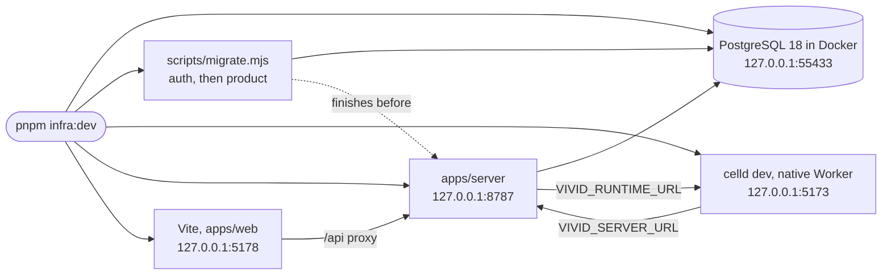
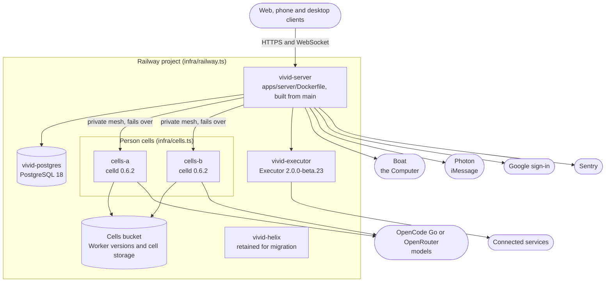
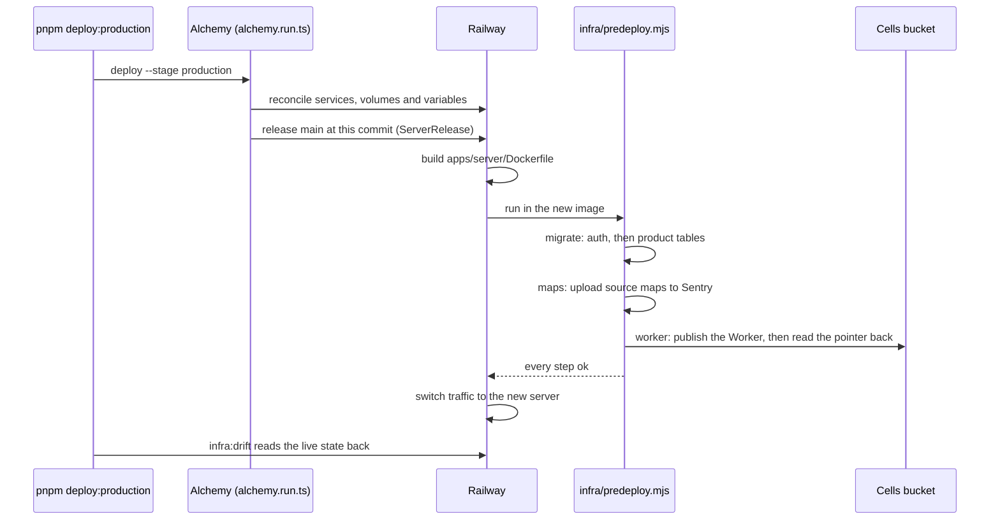

# Architecture

This document describes the parts Lucid is built from, how a request moves through them, and where
each part runs, locally and in production. Change it in the same commit as the code it describes.
[Infrastructure](19-infrastructure.md) keeps the full settings inventory and the history of
earlier hosting decisions.

Code identifiers keep the earlier name: packages are `@vivid/*`, the RPC group is `VividRpc`, and
settings start with `VIVID_`.

## The parts

Three clients talk to one application server. The server keeps product records in PostgreSQL and
hands each conversation to the Person cell of the Person who created the Thread. A Person cell is
one celld Durable Object per Person. It runs the agent with Pi Durable and keeps conversation
history and memory in its own SQLite database. The agent calls back into the server for every
product action, so authorization happens in one place.

### Applications

| Directory      | Package          | What it owns                                                                              | Built with                                        |
| -------------- | ---------------- | ----------------------------------------------------------------------------------------- | ------------------------------------------------- |
| `apps/web`     | `@vivid/web`     | Browser screens, routes and browser adapters for the shared client state                  | React 19.2, Vite 8.3, TanStack Router, Tailwind 4 |
| `apps/mobile`  | `@vivid/mobile`  | Native phone screens, device services and notifications                                   | Expo 57, React Native 0.86, Reanimated 4.5        |
| `apps/desktop` | `@vivid/desktop` | Electron windows around the web renderer, browsing, device pairing, local Computer access | Electron 44, electron-builder 26                  |
| `apps/server`  | `@vivid/server`  | Product APIs, authorization, PostgreSQL records and the gateway to Person cells           | Effect 4.1, Better Auth 1.7, Drizzle 1.0 rc, pg   |
| `apps/cells`   | `@vivid/cells`   | The celld Worker: Person cell lifetime, memory migrations, the Pi host                    | Pi Durable 1.4.0, celld 0.6.2                     |

### Packages

| Directory                | Package                 | What it owns                                                                      | Used by                                    |
| ------------------------ | ----------------------- | --------------------------------------------------------------------------------- | ------------------------------------------ |
| `packages/contracts`     | `@vivid/contracts`      | Wire schemas, branded ids, `VividRpc`, the runtime protocol                       | All five apps                              |
| `packages/client/rpc`    | `@vivid/client-runtime` | RPC clients derived from `VividRpc`, over HTTP and WebSocket                      | Web, phone, desktop, server, agent runtime |
| `packages/client/state`  | `@vivid/state`          | Live queries, caches, conversation following, optimistic sends                    | Web, phone                                 |
| `packages/agent/runtime` | `@vivid/agent-runtime`  | Pi conversation execution, instructions, model providers, tools, state projection | Cells                                      |
| `packages/agent/skills`  | `@vivid/skills`         | Built-in skill procedures and their manifest                                      | Cells, server                              |
| `packages/design/tokens` | `@vivid/tokens`         | Colour, type, radius and motion tokens as CSS, plus generated native values       | Web, phone                                 |
| `packages/design/marks`  | `@vivid/marks`          | Geometry for Lucid's face, figure and service marks                               | Web, phone                                 |
| `packages/compiler`      | `@vivid/compiler`       | Stops direct compiler commands, so repository checks own typechecking             | Root tooling                               |

`packages/agent/prompts`, `packages/agent/evals` and `packages/design/motion` hold only a README.
The agent's instructions live in `packages/agent/runtime/src/agents/vivid.ts`, and live checks sit
beside the code as `.live.test.ts` files.

### Server domains

`apps/server/src` has one directory per domain. A domain never imports another domain's internals,
only its exported service. `main.ts` (`serverProgram`) builds the Layers in tiers: config and
observability, the database, the durable work queue and auth, then the stores and outside clients,
then the domains that depend on them, and last the background workers. The last column names the
outside service a domain calls itself.

#### Identity and tenancy

| Domain        | What it owns                                                                                              | Talks to     |
| ------------- | --------------------------------------------------------------------------------------------------------- | ------------ |
| `appearance/` | Lucid's name and look where the Actor works: their own, or their Company's.                               |              |
| `auth/`       | Sessions, Google sign-in for web, desktop and phone, and who each product call acts for.                  | Google OAuth |
| `companies/`  | Companies, Memberships, invitations and the active workspace.                                             |              |
| `people/`     | Reserved for profiles and per-Person preferences. Today those live in `auth/` and `settings/`. Not built. |              |
| `settings/`   | A Person's own settings in every workspace: theme, time zone, location sharing, egress choice.            |              |

#### Conversations and runs

| Domain     | What it owns                                                                                                                       | Talks to                           |
| ---------- | ---------------------------------------------------------------------------------------------------------------------------------- | ---------------------------------- |
| `drafts/`  | A Person's unsent composer words, kept on the server so they follow the Person across devices.                                     |                                    |
| `dreams/`  | The `Dream` RPC: opens a hidden background Dreamer Thread and posts its finding to the Feed.                                       |                                    |
| `forget/`  | One forget of a Person's memory, from request to plan to the closure read back.                                                    | Cell runtime memory                |
| `inputs/`  | `ask_person` requests: one to four questions that survive the Run and resume work when all are answered.                           |                                    |
| `rooms/`   | Reserved for Lucid-to-Lucid messages across People and Companies. Shared Threads inside one Company live in `threads/`. Not built. |                                    |
| `runs/`    | Helper (child) Runs of a Run: up to four at once, their state, stop and follow-up.                                                 | Cell runtime                       |
| `runtime/` | The server's only client of the Person cell runtime: admit, watch, stop, memory, contract check.                                   | Cell runtime                       |
| `search/`  | The search palette over Threads, Library items and message text.                                                                   | Cell runtime `/persons/:id/search` |
| `threads/` | Threads, their audience, Runs, delivery of messages to the runtime, presence and titles.                                           | Cell runtime; OpenRouter titles    |

#### Work and tasks

| Domain      | What it owns                                                                                                    | Talks to                                            |
| ----------- | --------------------------------------------------------------------------------------------------------------- | --------------------------------------------------- |
| `feed/`     | The Feed: every open or recently settled Thread a Person owns, by stage, and pacing of what Lucid says unasked. |                                                     |
| `owed/`     | "Waiting on": things owed to a Person, with nudges and closure.                                                 |                                                     |
| `projects/` | Projects that group Threads and track their work to a completion with proof.                                    | Cell runtime, to read the completing Run's messages |
| `skills/`   | Procedures Lucid learned and can follow again, personal or Company-shared, plus built-ins.                      |                                                     |
| `todos/`    | A Person's own to-do list, which Lucid adds to and ticks off.                                                   |                                                     |
| `watches/`  | Watches: a Person's subscription to one Integration event, kept alive at Executor, with signed deliveries.      | Executor events API; receives Executor webhooks     |
| `work/`     | The list of background work (Runs, helpers, Watches, Computer commands) and Stop / Stop all.                    | Cell runtime abort, through `threads/stop.ts`       |

#### Integrations and approval

| Domain         | What it owns                                                                                                          | Talks to                                                                     |
| -------------- | --------------------------------------------------------------------------------------------------------------------- | ---------------------------------------------------------------------------- |
| `actions/`     | One receipt row per outward operation Lucid sent, so a retry finds its row and a client can reconcile it.             |                                                                              |
| `approvals/`   | The Gate for each consequential action: allow now, raise an Approval, or block by rule; then run the approved action. | OpenRouter decision model, only when `VIVID_DECISIONS=on`                    |
| `audit/`       | Append-only record of consequential events, written in the same transaction as the change.                            |                                                                              |
| `connections/` | Integrations: one Executor app per Connection, per-Person Executor members, tool calls and their effects.             | Executor; Google APIs as Executor app sources; Discord; OpenRouter decisions |
| `decisions/`   | The yes/no decision model (Jev) that the reviewer, rule judge and effect classifier use.                              | OpenRouter System One; off unless `VIVID_DECISIONS=on`                       |
| `rules/`       | Standing rules about what Lucid may do without asking, and the judge that applies them.                               | OpenRouter decisions                                                         |

#### Library and documents

| Domain       | What it owns                                                                     | Talks to |
| ------------ | -------------------------------------------------------------------------------- | -------- |
| `artifacts/` | Thread-owned Markdown documents with append-only version history.                |          |
| `library/`   | Personal and Company document shelves, folders, search, and PDF text extraction. |          |

#### Computer

| Domain       | What it owns                                                                                                                              | Talks to                                             |
| ------------ | ----------------------------------------------------------------------------------------------------------------------------------------- | ---------------------------------------------------- |
| `code/`      | Programs Lucid writes (`run_code`): admit, run on the Person's Computer, check each call the program makes.                               | Boat Computer over SSH; one public web page per read |
| `computers/` | The Person's cloud Computer (lifecycle, shell, desktop, browser, screen), their own enrolled devices, and egress through the desktop app. | Boat API; SSH to the machine                         |

#### Messaging and notifications

| Domain           | What it owns                                                                                        | Talks to                                                        |
| ---------------- | --------------------------------------------------------------------------------------------------- | --------------------------------------------------------------- |
| `activity/`      | iOS Live Activity cards (Lock Screen) that show up to three working Threads.                        | Apple APNs, direct                                              |
| `channels/`      | Talking to a Person over iMessage and Discord: linking, inbound messages, replies, delivery ledger. | Photon iMessage via `spectrum-ts`; Discord bot gateway and REST |
| `notifications/` | In-app notices for a Person and the delivery obligations for each channel.                          |                                                                 |
| `push/`          | Push targets per session and push delivery with receipts.                                           | Expo push; Web Push with VAPID                                  |

#### Platform

| Domain           | What it owns                                                                                            | Talks to                     |
| ---------------- | ------------------------------------------------------------------------------------------------------- | ---------------------------- |
| `builds/`        | Reports the commit this server was built from.                                                          |                              |
| `database/`      | The PostgreSQL client, the two schemas (identity, product) and the durable work queue.                  | PostgreSQL                   |
| `http/`          | The plain HTTP routes, static web files, Library uploads and client fault reports.                      |                              |
| `live/`          | Change notices that make open `Watch…` queries reload, and per-call counts.                             | PostgreSQL `LISTEN`/`NOTIFY` |
| `observability/` | Traces and logs export, Sentry issues, and Incidents (the one way the server says work did not happen). | OTLP endpoint; Sentry        |
| `rpc/`           | `VividRpc` over WebSocket (`/api/live`) and plain HTTP (`/api/rpc`), with every domain's handlers.      |                              |
| `updates/`       | Over-the-air updates for the mobile app (Expo Updates protocol), served from disk.                      |                              |

#### Entry points

| Path                                             | What it serves                                                                       |
| ------------------------------------------------ | ------------------------------------------------------------------------------------ |
| `/api/live`                                      | `VividRpc` over WebSocket, one socket per client (`rpc/link.ts`)                     |
| `/api/rpc`                                       | `VividRpc` over HTTP with NDJSON, used by the agent's tool calls (`rpc/requests.ts`) |
| `/api/auth/*`                                    | Better Auth sign-in and sessions                                                     |
| `/health`                                        | Readiness. It answers 503 when the cells speak another wire contract                 |
| `/api/library/*`, `/api/artifacts/*`             | Library and document file bytes                                                      |
| `/api/connections/return`                        | The OAuth return from a connected service                                            |
| `POST /api/watches/:id`                          | Executor event deliveries for Watches                                                |
| `/api/computer/screen/*`, `/api/computer/egress` | The Computer's screen and the desktop app's egress, over WebSocket                   |
| `/api/activity/action`                           | Live Activity button presses                                                         |
| `/api/updates/*`                                 | The phone app's over-the-air update, when `VIVID_MOBILE_UPDATES` is set              |
| `/*`                                             | The built web app, when `VIVID_WEB_DIST` is set                                      |

## One message, end to end

A Person sends a message from the web app. The same path serves the phone app.

| Step                     | Where                                                                                                 |
| ------------------------ | ----------------------------------------------------------------------------------------------------- |
| Composer and sending     | `apps/web/src/data/sending.ts`, `packages/client/state/src/sending.ts`                                |
| WebSocket client         | `apps/web/src/data/runtime.ts` (`liveAddress`), `packages/client/rpc/src/rpc.ts`                      |
| Server handlers          | `apps/server/src/rpc/server.ts`, `apps/server/src/threads/handlers.ts`                                |
| Admission and Runs       | `apps/server/src/threads/delivery.ts`, `apps/server/src/threads/runs.ts` (`RunStore`)                 |
| Cell client              | `apps/server/src/runtime/client.ts` (`makeRuntime`), `apps/server/src/runtime/transport.ts`           |
| Cell entry               | `apps/cells/src/main.ts` (`Person`)                                                                   |
| Agent runtime            | `packages/agent/runtime/src/cell.ts` (`openCell`), `src/person.ts` (`openPerson`), `src/admission.ts` |
| Model providers          | `packages/agent/runtime/src/providers/models.ts` (`makeProviders`)                                    |
| Tool calls to the server | `packages/agent/runtime/src/client.ts` (`productLayer`), `apps/server/src/rpc/requests.ts`            |
| State stream             | `packages/agent/runtime/src/app.ts` (`state`), `packages/client/state/src/conversation.ts`            |

Every call between the server and a cell carries `Authorization: Bearer` with
`VIVID_RUNTIME_TOKEN`. Tool calls also carry `x-vivid-thread` and `x-vivid-actor`, and the server
checks the Person's access again before it acts. The browser never sees the runtime token.

The cell belongs to the Thread's creator, so a second Person speaking in a shared Thread does not
move the conversation. `VIVID_RUNTIME_URL` lists every node. The server tries the next node only
when a node cannot be reached, and any node forwards to the cell's owner.

The default model is `opencode-go/glm-5.3-flash` through OpenCode Go. `VIVID_MODEL` can select
`openrouter/z-ai/glm-5.3-flash` through OpenRouter instead.

### Where data lives

| Data                                                               | Store                                                             |
| ------------------------------------------------------------------ | ----------------------------------------------------------------- |
| Conversation entries, live documents, tasks, run history           | Pi Durable tables (`pi_` prefix) in the creator's cell SQLite     |
| Memory, standing pages, sources and memory search (FTS5)           | The Person's cell SQLite (`packages/agent/runtime/src/memory.ts`) |
| Auth, Companies, Memberships, Thread metadata, Runs, Library files | PostgreSQL (`apps/server/src/database/client.ts`)                 |
| Integration accounts and credentials                               | Executor's own volume                                             |

## Infrastructure

Alchemy declares both environments in `alchemy.run.ts`. `VIVID_DEPLOY_TARGET` picks one:
`local` builds `localStack`, and `production` builds `railwayStack`. A third target, `preview`,
is declared in `infra/targets.ts` and refuses to run.

### Local

`pnpm infra:dev` starts five things on this machine. Nothing in the local graph needs a cloud
account. Boat, Executor, Photon and the push keys are outside services, and the server reads their
settings from the shell that started the stack.

| Process             | Address           | Declared in                             |
| ------------------- | ----------------- | --------------------------------------- |
| PostgreSQL 18       | `127.0.0.1:55433` | `infra/database.ts`, `infra/targets.ts` |
| Migrations          | runs once         | `alchemy.run.ts` (`Command.Exec`)       |
| Person cell (celld) | `127.0.0.1:5173`  | `alchemy.run.ts`, `infra/cli.mjs`       |
| Application server  | `127.0.0.1:8787`  | `alchemy.run.ts`                        |
| Web client          | `127.0.0.1:5178`  | `alchemy.run.ts`                        |

The server waits for migrations because it reads their hash (`VIVID_MIGRATIONS_HASH`), so it never
starts against a schema that does not exist yet.

### Production

Production runs in one Railway project. The application server is its only public service besides
Executor's sign-in pages. The server also serves the built web app (`VIVID_WEB_DIST`) and the
phone app's over-the-air update (`/api/updates`), so web, `/api` and WebSockets share one origin.

| Resource                  | Railway name         | What it holds                                                        | Declared at                            |
| ------------------------- | -------------------- | -------------------------------------------------------------------- | -------------------------------------- |
| Application server        | `vivid-server`       | Product logic, auth, the web build, the phone update                 | `infra/railway.ts`, `railwayResources` |
| PostgreSQL                | `vivid-postgres`     | Auth, Companies, Memberships, Thread metadata, Runs, Library files   | `infra/railway.ts`, `railwayResources` |
| Person cells              | `cells-a`, `cells-b` | One celld cell per Person: conversation history and memory in SQLite | `infra/cells.ts`, `railwayCells`       |
| Cells bucket              | `<stack>-cells`      | Published Worker versions, the pointer to the live one, cell storage | `infra/cells.ts`, `railwayCells`       |
| Executor                  | `vivid-executor`     | Integrations, connected accounts and their credentials               | `infra/railway.ts`, `railwayResources` |
| Helix and `RuntimeMemory` | `vivid-helix`        | Old memory, kept until its migration is removed                      | `infra/railway.ts`, `railwayResources` |
| Sentry alert rules        | none                 | Production alert policy, applied and read back                       | `infra/sentry.ts`, `SentryAlerts`      |
| Computer binaries         | GitHub release       | Binaries the desktop app fetches                                     | `infra/github.ts`                      |

A cell that stays quiet for five minutes hibernates (`CELLD_IDLE_EVICT_S`), and its next request
wakes it on the same node. Executor sleeps when idle, so the first Integration call after a quiet
spell waits for it to start.

Alchemy's state for production lives in a Cloudflare state store (`infra/state.ts`,
`hostedState`), so every machine plans against the same state.

### Release

`pnpm deploy:production` deploys the stack and then checks for drift (`infra/drift.mjs`). Railway
builds the server image from `main`. Before the new image takes traffic, Railway runs
`infra/predeploy.mjs` in it. A failed step keeps the previous deployment serving.

The Worker version is a hash that Alchemy computes (`CellWorker` in `infra/cells.ts`). The
pre-deploy step recomputes it from the image and stops the release when the two differ.
